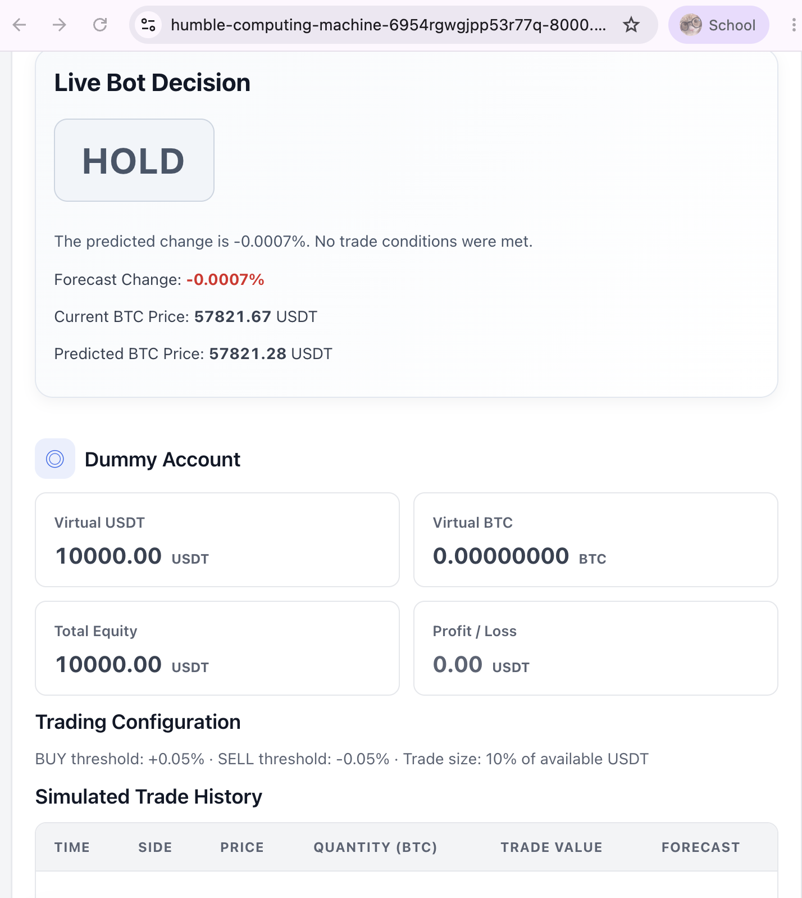
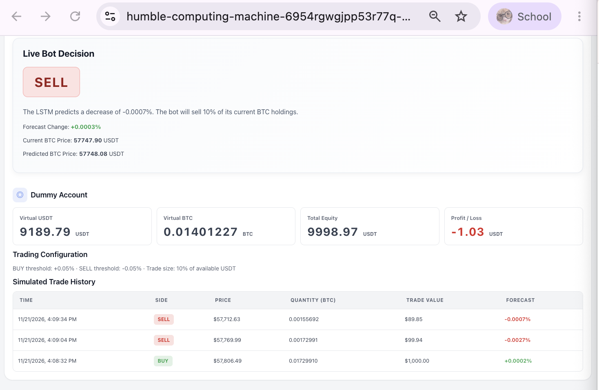
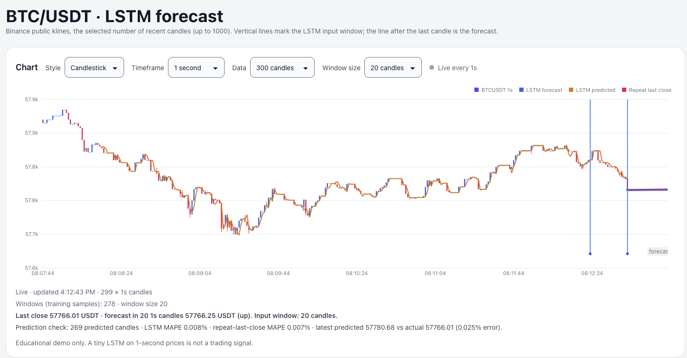
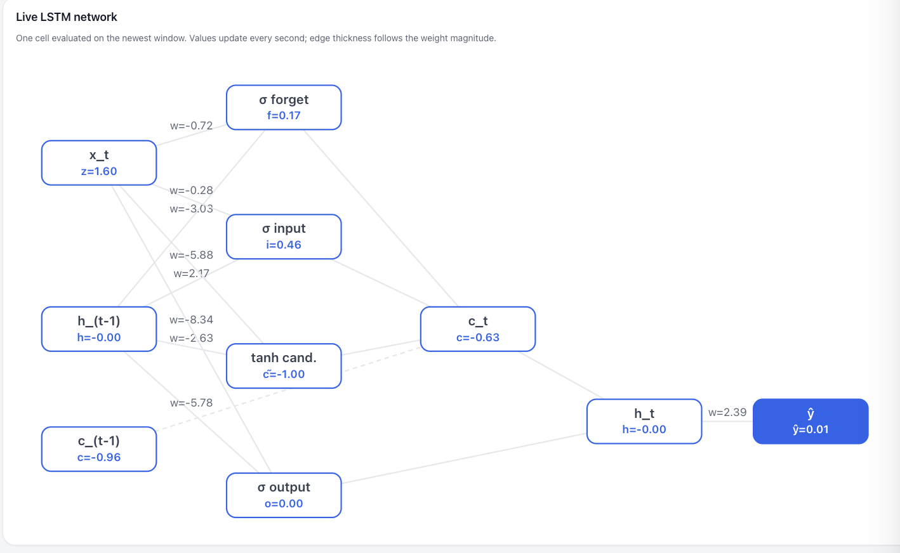
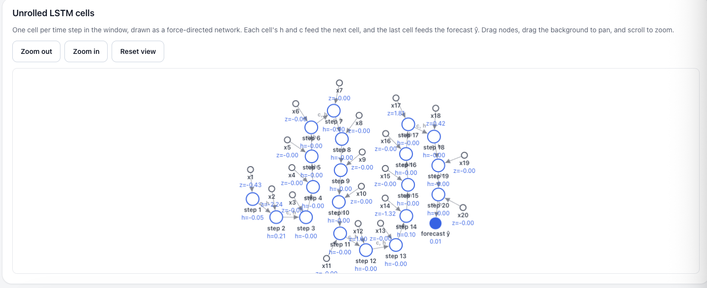

# BZUI-LSTM-BTCUSDT Paper Trading Bot

A web-based BTC/USDT forecasting dashboard with a simulated paper trading bot powered by a Tiny LSTM neural network.

This project adapts the original **BZUI-LSTM-BTCUSDT** reference repository by adding an in-code JavaScript dummy account, automated BUY/SELL/HOLD decisions based on LSTM forecasts, simulated trade execution, portfolio monitoring, and trade history.

The application uses publicly available BTC/USDT market data for educational purposes. All trading activities are simulated and do not involve real cryptocurrency transactions.

## Project Description

The BZUI-LSTM-BTCUSDT Paper Trading Bot was developed for a laboratory activity focused on implementing a simulated cryptocurrency trading system using an existing LSTM forecasting dashboard.

The original application was extended with a virtual wallet and trading bot that evaluates predicted BTC/USDT price movements and generates BUY, SELL, or HOLD decisions based on predefined percentage thresholds.

The application provides the following functionality:

- Live BTC/USDT market data using public market data.
- Candlestick price visualization.
- LSTM-based BTC/USDT price forecasting.
- Live LSTM network visualization.
- Unrolled LSTM cell visualization.
- JavaScript-based virtual cryptocurrency wallet.
- Automated BUY, SELL, and HOLD decisions.
- Simulated order execution.
- Virtual USDT and BTC balance monitoring.
- Total portfolio equity calculation.
- Profit and Loss (PnL) monitoring.
- Simulated trade history.
- Start, Stop, and Reset controls for the trading bot.

The main purpose of this project is to demonstrate how machine learning forecasting can be integrated into a basic automated trading strategy while allowing transactions to be tested using a virtual account instead of real funds.

## Technologies Used

- HTML
- CSS
- JavaScript
- Tiny LSTM Neural Network
- Binance Public Market Data
- Git
- GitHub
- GitHub Codespaces
- Python HTTP Server

## Project Structure

```text
BZUI-LSTM-BTCUSDT/
|
|-- index.html
|-- app.js
|-- tiny-lstm.js
|-- unroll-graph.js
|-- LICENSE
|-- README.md
|
|-- screenshots/
|   |-- 1.png
|   |-- 2.png
|   |-- 3.1.png
|   |-- 3.2.png
|   |-- 3.3.png
```

### File Descriptions

| File | Description |
|---|---|
| `index.html` | Main dashboard interface containing the chart, trading bot controls, account information, and trade history. |
| `app.js` | Main JavaScript application containing market data handling, LSTM forecasting, dummy account management, trading decisions, simulated order execution, and UI updates. |
| `tiny-lstm.js` | Contains the Tiny LSTM implementation used for forecasting. |
| `unroll-graph.js` | Handles the visualization of the unrolled LSTM network. |
| `screenshots/` | Contains screenshots documenting the application and testing results. |
| `README.md` | Project documentation. |
| `LICENSE` | License information for the project. |

## Dummy Account and Trading Strategy

The application uses an in-code JavaScript virtual wallet to simulate cryptocurrency trading.

The initial dummy account is configured with:

| Account Asset | Initial Balance |
|---|---:|
| Virtual USDT | 10,000.00 USDT |
| Virtual BTC | 0.00000000 BTC |
| Total Equity | 10,000.00 USDT |
| Profit / Loss | 0.00 USDT |

The dummy account is maintained entirely within the application's JavaScript state. It does not connect to a real cryptocurrency exchange account or execute actual transactions.

### Trading Configuration

The bot uses the following trading parameters:

| Parameter | Value |
|---|---|
| Initial Virtual Balance | 10,000 USDT |
| BUY Threshold | +0.05% |
| SELL Threshold | -0.05% |
| BUY Trade Size | 10% of available virtual USDT |
| SELL Trade Size | 10% of current virtual BTC holdings |

### LSTM Signal Generation

The trading bot uses the existing LSTM forecasting pipeline to predict the future BTC/USDT price.

The predicted price is compared against the latest available BTC/USDT closing price to calculate the expected percentage change.

The expected percentage change is calculated using:

```text
Predicted Change (%) =
((Predicted Price - Current Price) / Current Price) × 100
```

The bot uses the predicted percentage change to determine its trading decision.

### BUY Decision

A BUY signal is generated when:

- The predicted price increase exceeds the BUY threshold.
- Virtual USDT is available.
- The dummy account does not currently hold BTC.

When a BUY signal is triggered, the bot uses 10% of the available virtual USDT to purchase BTC at the simulated execution price.

### SELL Decision

A SELL signal is generated when:

- The predicted price decrease exceeds the SELL threshold.
- The dummy account currently holds BTC.

When a SELL signal is triggered, the bot sells 10% of its current virtual BTC holdings.

### HOLD Decision

A HOLD signal is generated when the BUY or SELL conditions are not satisfied.

The bot may also HOLD when a signal is generated but the required asset is unavailable. For example, the bot cannot BUY when it already holds BTC under the current strategy, and it cannot SELL when it has no BTC holdings.

## Simulated Order Execution

When a BUY or SELL decision is triggered, the application updates the virtual wallet balances.

### BUY Transaction

During a simulated BUY transaction:

1. The bot calculates 10% of the available virtual USDT.
2. The calculated amount is used to purchase BTC at the current simulated price.
3. The virtual USDT balance is reduced.
4. The virtual BTC balance is increased.
5. The transaction is recorded in the simulated trade history.

### SELL Transaction

During a simulated SELL transaction:

1. The bot calculates 10% of the current virtual BTC holdings.
2. The calculated BTC amount is sold at the current simulated price.
3. The virtual BTC balance is reduced.
4. The virtual USDT balance is increased.
5. The transaction is recorded in the simulated trade history.

### Portfolio Monitoring

The dashboard dynamically displays:

- Virtual USDT balance
- Virtual BTC balance
- Total portfolio equity
- Profit or Loss
- Current BTC price
- Predicted BTC price
- Forecast percentage change
- Current bot decision
- Bot execution status
- Simulated trade history

The total portfolio equity is calculated based on the virtual USDT balance and the current market value of the virtual BTC holdings.

The Profit/Loss is calculated by comparing the total portfolio equity against the initial virtual account balance.

## User Interface Controls

The application provides the following controls:

| Control | Function |
|---|---|
| Start Bot | Starts the automated paper trading bot. |
| Stop Bot | Stops automated trading decisions. |
| Reset Account | Restores the dummy account to its initial balance and clears the simulated trade history. |
| Test BUY | Manually tests a simulated BUY transaction. |
| Test SELL | Manually tests a simulated SELL transaction. |

The Test BUY and Test SELL controls are provided for testing the simulated transaction functionality.

## Installation and Setup

### 1. Fork or Clone the Repository

Fork the original reference repository or clone your own repository.

```bash
git clone https://github.com/YOUR-USERNAME/BZUI-LSTM-BTCUSDT.git
```

Replace `YOUR-USERNAME` with your GitHub username.

Navigate into the project directory:

```bash
cd BZUI-LSTM-BTCUSDT
```

### 2. Open the Project

Open the repository using Visual Studio Code or GitHub Codespaces.

Make sure the following files are present:

```text
index.html
app.js
tiny-lstm.js
unroll-graph.js
```

### 3. Run the Application

The application can be served using a local HTTP server.

Open the terminal in the project root directory and run:

```bash
python3 -m http.server 8000
```

### 4. Access the Dashboard

Open your browser and navigate to:

```text
http://localhost:8000
```

When using GitHub Codespaces, open the Ports tab and access the forwarded port 8000 URL.

The dashboard should load and begin displaying public BTC/USDT market data.

## Usage Instructions

### 1. Open the BTC/USDT Dashboard

Open the application in your browser.

The dashboard displays the BTC/USDT price chart, market data, and LSTM forecasting information.

### 2. Select a Timeframe

Choose a timeframe using the dashboard controls.

The application allows the user to select the candle interval and the amount of historical market data used for visualization and forecasting.

### 3. Monitor the LSTM Forecast

The LSTM forecast is displayed alongside the BTC/USDT price chart.

The application also provides the following visualizations:

- LSTM forecast chart
- Live LSTM network
- Unrolled LSTM cells

These visualizations help demonstrate the forecasting process and the structure of the LSTM model.

### 4. Start the Paper Trading Bot

Click the **Start Bot** button.

The bot evaluates the LSTM forecast and compares the predicted price movement against the configured BUY and SELL thresholds.

The dashboard displays the current decision:

- BUY
- SELL
- HOLD

### 5. Monitor the Dummy Account

The Dummy Account section displays the updated virtual balances.

The account includes:

- Virtual USDT
- Virtual BTC
- Total Equity
- Profit / Loss

These values update after simulated transactions and market price changes.

### 6. Review Simulated Trade History

The Simulated Trade History table records executed simulated transactions.

Each transaction includes:

- Timestamp
- Transaction type
- Execution price
- BTC quantity
- Trade value
- Forecast percentage

This allows the user to review the trading bot's decisions and simulated transactions.

### 7. Reset the Dummy Account

Click **Reset Account** to restore the virtual account to its initial state.

The account returns to:

```text
Virtual USDT: 10,000.00 USDT
Virtual BTC:  0.00000000 BTC
Total Equity: 10,000.00 USDT
Profit/Loss:  0.00 USDT
```

This allows repeated testing of the paper trading bot.

## Test Results and Screenshots

The following screenshots document the application and the paper trading bot's functionality.

### Screenshot 1 — Dummy Account and Portfolio Summary

The screenshot shows the initial dummy account, including the virtual USDT balance, virtual BTC balance, total portfolio equity, and Profit/Loss.

It also displays the trading configuration and the simulated trade history before transactions are executed.



### Screenshot 2 — Simulated Trade Execution Log

The screenshot demonstrates the paper trading bot executing simulated BUY and SELL transactions.

The dashboard displays the current bot decision, LSTM forecast, virtual account balances, total equity, Profit/Loss, and simulated trade history.

The trade history records the transaction timestamps, execution prices, BTC quantities, trade values, and forecast percentages.



### Screenshot 3.1 — BTC/USDT LSTM Forecast

The screenshot shows the BTC/USDT price chart with the LSTM forecast overlay.

It also displays the selected timeframe, historical candles, forecast information, and model prediction details.



### Screenshot 3.2 — Live LSTM Network

The screenshot displays the live LSTM network visualization.

It shows the input, forget, and output gates, along with the cell state, hidden state, and predicted output.



### Screenshot 3.3 — Unrolled LSTM Cells

The screenshot displays the unrolled LSTM network across multiple time steps.

It demonstrates how the LSTM cells process sequential input data and pass hidden states and cell states through the network.



## Limitations

This project is intended for educational and experimental purposes.

The application has the following limitations:

- The trading bot uses simulated transactions only.
- No real cryptocurrency is purchased or sold.
- The virtual wallet is maintained in JavaScript memory.
- Account data and trade history may be reset when the application is refreshed or reset.
- The LSTM model is used for educational forecasting and is not guaranteed to predict actual market movements.
- The trading strategy uses simple percentage thresholds and does not include advanced risk management.
- Trading fees, slippage, and other real-world trading costs are not fully modeled.
- The application should not be used as financial advice or as a real trading system.

## Conclusion

The project demonstrates how an existing LSTM-based cryptocurrency forecasting dashboard can be extended into a basic paper trading application.

By implementing a JavaScript dummy account, automated BUY/SELL/HOLD decisions, simulated order execution, portfolio monitoring, and trade history, the application provides a practical demonstration of how machine learning forecasting can be integrated into a simulated trading environment.

The project also demonstrates the importance of testing trading strategies without risking real funds.

## License

This project follows the license provided in the original repository. Refer to the `LICENSE` file for additional information.
